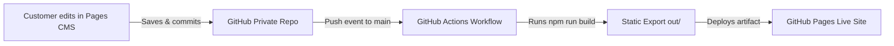

# BrandSpace Agency Website - Next.js & Pages CMS

A modern, high-performance agency website built with Next.js 16 and fully integrated with **Pages CMS** for Git-based, serverless content management.

---

## Getting Started Locally

### Prerequisites
- Node.js 18.18+ (Node.js 20 LTS or Node.js 22 recommended)
- npm 10+

### Installation & Development
```bash
# Install dependencies with legacy peer dependency handling
npm install --legacy-peer-deps

# Start the local development server
npm run dev
```

Open [http://localhost:3000](http://localhost:3000) in your browser.

### Static Export Build
To test the production static export:
```bash
npm run build
```
The static site output will be generated in the `out/` directory ready for deployment to GitHub Pages.

---

## Pages CMS Setup

### 1. What Pages CMS Does in This Project
[Pages CMS](https://pagescms.org/) is an open, Git-based content management system that operates directly on your GitHub repository. It allows nontechnical clients to edit copy, update images, and manage portfolio items through an intuitive web interface, without needing:
- Any custom backend or API server
- Any database (PostgreSQL, MySQL, Supabase, Firebase, etc.)
- Any VPS or hosting server maintenance
- Any client-side GitHub Personal Access Tokens (PATs)

> [!IMPORTANT]
> Pages CMS is a **hosted application** accessed exclusively at **[https://app.pagescms.org/](https://app.pagescms.org/)**. 
> There is **no local `/admin` dashboard** or embedded backend inside this website repository. Customers log in to the official hosted dashboard at `https://app.pagescms.org/`.

---

### 2. Configuration File (`.pages.yml`)
All CMS settings, media directories, and schema definitions live in a single file in the repository root:
- Location: [`.pages.yml`](.pages.yml)

Pages CMS automatically reads `.pages.yml` when connecting to your GitHub repository and generates the editing interface based on the defined fields.

---

### 3. Editable Content Files
The CMS is configured to read and write directly to structured JSON files inside `public/assets/jsonData/`:

| Section | Content File | Structure | Key Editable Fields |
| :--- | :--- | :--- | :--- |
| **Site Settings** | `public/assets/jsonData/settings/siteSettings.json` | Single Object | Brand name, header/footer logos, contact email, phone, physical address, copyright, social media links. |
| **Homepage** | `public/assets/jsonData/homepage/homeData.json` | Single Object | Hero titles, quote paragraphs, author details, primary CTA button & link, about text, project section header. |
| **Services** | `public/assets/jsonData/services/ServicesV1Data.json` | Array / List | Service ID, title, icon, card thumbnail, detail showcase images (`thumbFull1`, `thumbFull2`), description, pricing. |
| **Featured Projects** | `public/assets/jsonData/feature/FeatureV1Data.json` | Array / List | Project ID, name, category tag, subtitle lines, showcase image, date. |
| **All Projects (Portfolio)**| `public/assets/jsonData/feature/FeatureV2Data.json` | Array / List | Project ID, name, category tag, description lines, showcase image, date. |
| **Blog & Articles** | `public/assets/jsonData/feature/FeatureV3Data.json` | Array / List | Article ID, headline, secondary title, author, date, category tag, thumbnail, full cover image. |
| **Team Members** | `public/assets/jsonData/team/TeamV1Data.json` | Array / List | Member ID, full name, role / designation, bio text, portrait photo. |
| **Testimonials** | `public/assets/jsonData/testimonial/TestimonialData.json` | Array / List | Review ID, client name, role & company, quote feedback, client avatar. |
| **FAQ** | `public/assets/jsonData/faq/FaqData.json` | Object with List | Section subtitle, title, description, and list of questions with answers. |
| **Company Values** | `public/assets/jsonData/services/ServicesV2Data.json` | Array / List | Value ID, title, description, icon / illustration. |
| **Work Process** | `public/assets/jsonData/process/ProcessV1Data.json` | Array / List | Step ID, Roman numeral, step name, subtitle, description, step image. |
| **Fun Facts & Stats** | `public/assets/jsonData/fact/FactData.json` | Array / List | Stat ID, title, metric number (animated counter), icon. |
| **Awards** | `public/assets/jsonData/awards/AwardsV1Data.json` | Array / List | Award ID, title, year / award period. |
| **Client Logos** | `public/assets/jsonData/partner/PartnerData.json` | Array / List | Partner ID, client logo image. |

---

### 4. Image Uploads & Asset Resolution

- **Upload Directory in Repository:** `public/uploads/`
- **Public URL Written to Content:** `/uploads/<filename>`
- **Supported Formats:** JPG, JPEG, PNG, WebP, SVG, GIF

#### How Image Resolution Works
The template includes a universal image helper (`src/components/utilities/getImageUrl.ts`):
1. **Newly Uploaded Images:** Paths starting with `/uploads/` or `/` are served directly from the public web root.
2. **Legacy Theme Assets:** Filenames like `service1.png` or `project-1.jpg` automatically map to their respective `/assets/images/...` theme folders.

This ensures existing template graphics remain 100% intact while allowing clients to upload custom images seamlessly via Pages CMS.

---

### 5. Connecting Your Private GitHub Repository to Pages CMS

To link your repository with Pages CMS:

1. Visit **[https://app.pagescms.org/](https://app.pagescms.org/)** and sign in using your GitHub account (the account that owns or administers this repository).
2. Click **Add repository** or **Connect repository**.
3. When prompted, install the official **Pages CMS GitHub App** on your GitHub account or organization:
   - Select **Only select repositories**.
   - Choose your repository (e.g. `brandspacebd/brandspace-website`).
   - Grant repository read and write access for content commits.
4. Select the `main` branch as your default working branch.
5. Pages CMS will immediately read `.pages.yml` and display the content sidebar.

---

### 6. Inviting Customers by Email (No GitHub Account Needed)

To give your customer access to edit content without giving them access to your GitHub repository:

1. Open your repository in the hosted dashboard at **[https://app.pagescms.org/](https://app.pagescms.org/)**.
2. Navigate to **Settings** -> **Collaborators**.
3. Click **Invite Collaborator**.
4. Enter your customer's email address and send the invitation.
5. **Customer Experience:**
   - The customer receives an invitation email with a magic login link.
   - They log in to `https://app.pagescms.org/` using their email (no GitHub account required).
   - They can only view and edit the fields defined in `.pages.yml` and upload media.
   - They **cannot** view repository source code, workflows, package configurations, or invite other collaborators.

---

### 7. How Content Changes Trigger Automatic Deployment



1. The customer makes a content change or uploads an image in the Pages CMS interface and clicks **Save**.
2. Pages CMS makes a Git commit directly to the `main` branch of your private repository on behalf of the collaborator.
3. The commit triggers the GitHub Actions workflow defined in [`.github/workflows/deploy.yml`](.github/workflows/deploy.yml).
4. GitHub Actions installs dependencies, builds the Next.js static export (`out/`), and deploys it to **GitHub Pages**.
5. Within 1-2 minutes, the live website reflects the updated content.

---

### 8. Configuring GitHub Pages and GitHub Actions

To enable automatic deployment in GitHub:

1. Navigate to your repository on GitHub: `https://github.com/<owner>/<repo>/settings/pages`.
2. Under **Build and deployment**:
   - **Source:** Select **GitHub Actions** (do NOT select "Deploy from a branch").
3. Go to **Settings** -> **Actions** -> **General**:
   - Under **Workflow permissions**, ensure **Read and write permissions** is selected (or ensure permissions declared in `deploy.yml` are allowed).
4. Verify the deployment:
   - Under the repository's **Actions** tab, observe the "Deploy Next.js Static Export to GitHub Pages" workflow.
   - You can also trigger it manually at any time using the **Run workflow** button (`workflow_dispatch`).

> [!NOTE]
> **Private Repositories & GitHub Pages:**
> GitHub Pages is included for public repositories on GitHub Free. For private repositories, GitHub Pages requires a GitHub Pro, GitHub Team, or GitHub Enterprise plan. If your repository is private on a free plan, you can either upgrade to GitHub Pro ($4/mo) or make the repository public. Alternatively, you can deploy the generated static export to Cloudflare Pages or Vercel with zero cost.

---

### 9. Troubleshooting

#### Invalid JSON or Broken Content
- **Symptom:** Build fails with `SyntaxError: Unexpected token in JSON` or missing field error.
- **Cause:** A required field was left blank or deleted.
- **Solution:** Verify that all required fields (`id`, `name`, `title`) in the CMS are filled out. Pages CMS validates schemas defined in `.pages.yml` prior to committing.

#### Broken Detail Routes (`/service-details/[id]`, `/blog-details/[id]`, etc.)
- **Symptom:** 404 error when clicking a service or blog post on the static site.
- **Cause:** When creating a new service or blog post, ensure a unique integer `id` is specified (e.g. `5`, `6`). In static export mode, Next.js generates static routes at build time using `generateStaticParams()`.

#### Missing or Broken Images
- **Symptom:** Image shows as a broken link.
- **Cause:** The image was referenced before being committed, or filename contains unsupported characters.
- **Solution:** Upload images through the CMS media picker to store them in `public/uploads/`. The image URL should appear as `/uploads/your-image.png`.

#### Failed GitHub Actions Builds
- **Symptom:** The workflow in GitHub Actions displays a red X.
- **Solution:** Click on the failed run under the **Actions** tab, expand the `Build Next.js static site` step, and review the exact compiler error.

---

### 10. Manual Steps Checklist

To finalize your setup after pushing this repository to GitHub:

- [ ] Push changes to `main` branch on GitHub.
- [ ] In GitHub repo: **Settings -> Pages -> Source**, set to **GitHub Actions**.
- [ ] Log in to **[https://app.pagescms.org/](https://app.pagescms.org/)** and install the Pages CMS GitHub App.
- [ ] Connect your repository and verify all content tabs appear in the left sidebar.
- [ ] In Pages CMS Settings -> Collaborators, invite your client's email address.
- [ ] Make a test edit in Pages CMS to verify automatic build and deployment.
