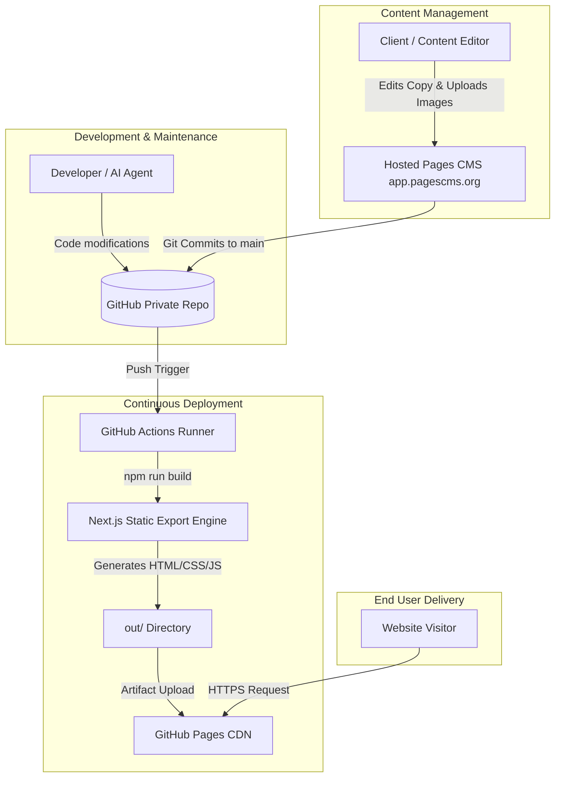

# 01 - Architecture & Technology Stack
## Brandspace / Aixor Agency Next.js Static Website

This document provides a deep architectural breakdown of the technology stack, build pipeline, component paradigms, and design patterns utilized in this project.

---

## 1. System Architecture Overview

The system is engineered as an **immutable, Git-backed static frontend**:



### Why This Architecture?
1. **Zero Attack Surface:** Without a Node.js server, SQL database, or runtime API endpoints, typical web application vulnerabilities (SQL injection, SSRF, remote code execution, server authentication bypass) do not exist.
2. **Infinite Scalability:** Static files served via GitHub Pages (or any CDN like Cloudflare) can handle high-traffic spikes without scaling bottlenecks or infrastructure costs.
3. **Low Latency & High Speed:** Pages are pre-rendered into static HTML and optimized JavaScript, delivering near-instant First Contentful Paint (FCP) and Time to Interactive (TTI).
4. **Version-Controlled Content:** Every single copy edit, image upload, or deletion is a standard Git commit on `main`. Full rollback history is available at any time.

---

## 2. Core Technologies

### 2.1 Next.js 16.0.0 (App Router)
- **Engine:** Next.js 16 with Turbopack for compilation.
- **Routing Paradigm:** App Router located in `src/app/`.
- **Static Export Mode:** Configured with `output: 'export'` in `next.config.mjs`.
  - In this mode, Next.js executes all page components and layouts during the build phase (`npm run build`).
  - Statically generated HTML files are written into the root `out/` directory.
  - Server-only features (e.g. `headers()`, `cookies()`, dynamic server-side API routes, and Incremental Static Regeneration) are disabled in favor of static generation.

### 2.2 React 19.2.0
- Uses React 19 with the experimental React Compiler plugin configured in `devDependencies` (`babel-plugin-react-compiler`).
- **Client Components (`'use client'`):**
  - Most UI components handling interactive state (e.g. mobile menus, GSAP animations, counter animations, accordions) declare `'use client'` at the top of the file.
  - Because Next.js pre-renders Client Components to static HTML during build time, SEO and initial page rendering remain fast and indexable.

### 2.3 Bootstrap 5.3.8 & Global CSS
- **Layout Grid:** Bootstrap 5 grid system (`container`, `row`, `col-lg-...`, etc.) powers all responsive layouts.
- **CSS Bundle:** Imported in `src/app/layout.tsx`:
  - `bootstrap/dist/css/bootstrap.min.css`
  - `/assets/css/all.min.css` (FontAwesome icons)
  - `/assets/css/animate.css` (CSS animations)
  - `/assets/css/flaticon.css` (Template custom icon fonts)
  - `/assets/css/style.css` (Aixor theme primary styling)

### 2.4 Animation Engines
- **GSAP (`gsap` 3.13.0):** Used for advanced timeline animations, smooth text appearance, hero banner interactions, and scroll transitions.
- **AOS (`aos` 2.3.4):** "Animate on Scroll" library providing smooth scroll-triggered fades and slide-ins across cards and sections.
- **React CountUp (`react-countup` 6.5.3):** Animates statistics and numbers when they scroll into viewport (used in `FactData.json`).

---

## 3. Configuration Deep Dive

### 3.1 `next.config.mjs`
```javascript
/** @type {import('next').NextConfig} */
const nextConfig = {
    output: 'export',
    images: {
        unoptimized: true
    }
};

export default nextConfig;
```
- **`output: 'export'`**: Tells Next.js to produce static HTML/CSS/JS in `out/`.
- **`images: { unoptimized: true }`**: Standard Next.js Image Optimization requires a persistent Node.js server. In a static export on GitHub Pages, setting `unoptimized: true` allows `next/image` components to render standard high-performance `` elements pointing directly to `/uploads/...` or `/assets/images/...` without requiring an optimization server.

### 3.2 `.npmrc`
```ini
legacy-peer-deps=true
```
- **Why it exists:** React 19 introduces strict peer dependency checks. Some third-party animation helper packages (such as `react-simple-scroll-up`) declare peer dependencies for React 17 or 18. Setting `legacy-peer-deps=true` ensures `npm install` and `npm ci` resolve smoothly both on local development machines and inside the GitHub Actions Ubuntu runner.

### 3.3 `tsconfig.json`
- Targets `ES2017` with `ESNext` module resolution.
- Configures path alias `@/*` pointing to `./src/*`.
- Enables `strict: true` for TypeScript compiler verification.

---

## 4. Component Architecture & Data Flow

```plaintext
[JSON Content File] (e.g. public/assets/jsonData/homepage/homeData.json)
        │
        ▼ (Direct ESM import)
[React Component] (e.g. src/components/hero/HeroV1.tsx)
        │
        ▼ (Image resolution via getImageUrl utility)
[Rendered Output] (Semantic HTML, styled with Bootstrap & animated via GSAP)
```

1. **Zero Runtime Network Fetching:** Data is imported directly into components at build time using ES module imports:
   ```typescript
   import homeData from "@/../public/assets/jsonData/homepage/homeData.json";
   ```
2. **Instant Rendering:** Because there is no client-side `fetch()` call on page load, there are no skeleton loaders, content flashes, or layout shifts (CLS). Content is baked directly into the static HTML.
3. **Separation of Presentation & Data:** Components do not contain hardcoded copy. All headings, descriptions, button labels, URLs, and image filenames are passed from the structured JSON files.

---
*Authored for the Brandspace Engineering & AI Pair-Programming Team.*
