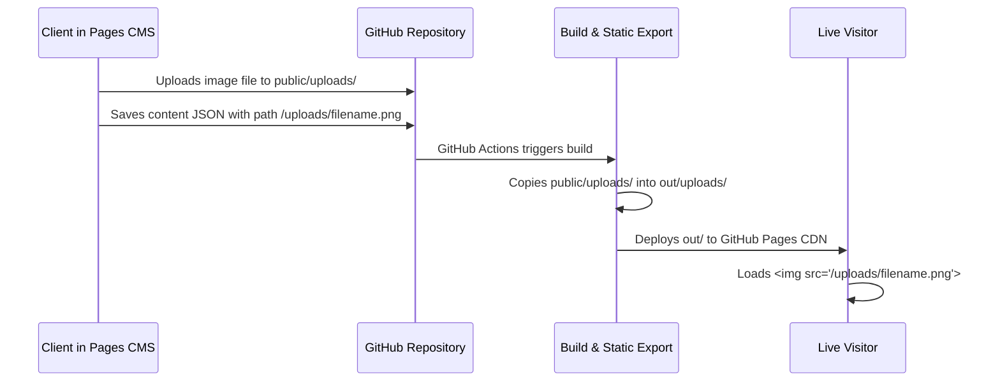

# 03 - Media Pipeline & Image Handling
## Brandspace / Aixor Agency Next.js Static Website

This document explains the media pipeline, image upload configuration, path resolution logic, and Next.js static asset integration.

---

## 1. Media Upload Pipeline

Pages CMS provides a media picker directly inside the content editing UI. When an editor clicks an image field and uploads a new graphic:



### Pages CMS Media Configuration (`.pages.yml`)
```yaml
media:
  input: public/uploads
  output: /uploads
  categories: [image]
  extensions: [jpg, jpeg, png, webp, svg, gif]
```

- **`input: public/uploads`**: Instructs Pages CMS to commit all uploaded media into the `public/uploads/` directory inside the repository.
- **`output: /uploads`**: Instructs Pages CMS to write root-relative URLs (e.g. `/uploads/my-photo.webp`) into the JSON content files when an image is chosen.
- **`categories: [image]` & `extensions:`**: Restricts file uploads exclusively to safe image types, preventing accidental uploads of executable binaries, scripts, or unsupported formats.

---

## 2. Universal Image Path Resolver (`getImageUrl`)

### The Challenge
1. **Legacy Theme Assets:** The original Aixor template contains hundreds of existing images organized in `public/assets/images/` subfolders (e.g. `public/assets/images/service/service1.png`, `public/assets/images/projects/project-1.jpg`). Their JSON files only store the base filename: `"thumb": "service1.png"`.
2. **New Uploads from Pages CMS:** When a client uploads a new image via Pages CMS, the stored value is an absolute web path: `"/uploads/custom-photo.jpg"`.
3. **Requirement:** Both legacy theme assets and newly uploaded CMS images must render without breaking layout or requiring a destructive migration of existing assets.

### The Solution: `src/components/utilities/getImageUrl.ts`
```typescript
/**
 * Resolves image paths seamlessly for both legacy theme assets
 * and newly uploaded Pages CMS media.
 *
 * @param imagePath The image filename or path from JSON data
 * @param fallbackDir Optional directory path for legacy template images (e.g., '/assets/images/service/')
 * @returns Fully qualified public URL for the image
 */
export function getImageUrl(imagePath?: string, fallbackDir: string = "/assets/images/"): string {
    if (!imagePath) return "/assets/images/logo/logo-1.png";
    
    // If it's already an absolute web path, URL, or Pages CMS upload
    if (imagePath.startsWith("/") || imagePath.startsWith("http://") || imagePath.startsWith("https://")) {
        return imagePath;
    }
    
    // Ensure fallbackDir ends with a slash
    const dir = fallbackDir.endsWith("/") ? fallbackDir : `${fallbackDir}/`;
    
    return `${dir}${imagePath}`;
}
```

### Usage Pattern in Components
Every component displaying dynamic images imports and calls `getImageUrl`:

```tsx
import Image from "next/image";
import { getImageUrl } from "@/components/utilities/getImageUrl";

// Example in a Service Card:
<Image 
    src={getImageUrl(service.thumb, "/assets/images/service/")} 
    alt={service.name} 
    width={600} 
    height={400} 
/>
```

- **Case 1 (Legacy theme asset):** If `service.thumb` is `"service1.png"`, `getImageUrl` returns `"/assets/images/service/service1.png"`.
- **Case 2 (Client-uploaded CMS asset):** If `service.thumb` is `"/uploads/new-service.webp"`, `getImageUrl` detects the leading slash and returns `"/uploads/new-service.webp"` unchanged.

---

## 3. Next.js Static Export & `<Image>` Optimization

In traditional server-rendered Next.js applications, `next/image` proxies images through an internal Node.js endpoint `/_next/image?url=...&w=...&q=...` to dynamically resize and recompress them on the server.

On **GitHub Pages** (a purely static host with no Node.js runtime):
- An image optimization server is not available.
- Without proper configuration, `next/image` throws an export error:  
  `Image Optimization using Next.js default loader is not compatible with 'output: export'`.

### Configuration in `next.config.mjs`
```javascript
const nextConfig = {
    output: 'export',
    images: {
        unoptimized: true
    }
};
```
Setting `unoptimized: true` tells Next.js to render standard responsive `` tags pointing directly to the static assets. This preserves all Next.js layout features, responsive aspect ratios, and blur effects while allowing static compilation without a server.

---

## 4. Git Repository Tracking for Uploads

Because Git does not track empty directories, the repository includes a tracking file:
- `public/uploads/.gitkeep`

This guarantees the `public/uploads/` folder exists immediately upon initial clone or inside CI/CD environments, preventing build failures before the first CMS image is uploaded.

---
*Authored for the Brandspace Engineering & AI Pair-Programming Team.*
